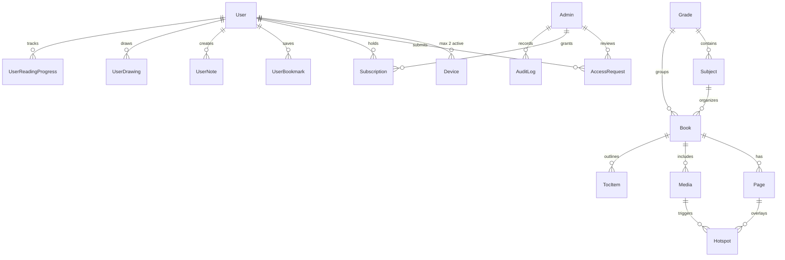

# 📘 Ilmçi (ilmchi.uz) — Loyihaning To‘liq Texnik va Amaliy Hujjati (PROJECT CONTEXT)

> Ushbu hujjat **Ilmçi** ta’lim platformasining arxitekturasi, biznes mantig‘i, texnologik steki, qabul qilingan muhim qarorlari va joriy holatini yangi Antigravity sessiyasida yoki boshqa dasturchilar tomonidan hech qanday ma’lumot yo‘qotmasdan davom ettirish uchun to‘liq qo‘llanma sifatida tayyorlangan.

---

## 1. PROJECT OVERVIEW (Loyihaning Umumiy Tavsifi)

### 1.1. Loyihaning Maqsadi
**Ilmçi (ilmchi.uz)** — O‘zbekiston umumta’lim maktablarining 1–11-sinf o‘qituvchilari uchun mo‘ljallangan milliy raqamli darsliklar, interaktiv multimediyalar va metodik yordamchi platformasidir.
Loyiha o‘qituvchilarga dars jarayonida barcha o‘quv adabiyotlari (Darslik, O‘qituvchi kitobi, Mashq daftari), audio tinglash materiallari va videolarni yagona qulay ekranda, ham onlayn, ham 100% oflayn (internetsiz) rejimda ishlatish imkonini beradi.

### 1.2. Qanday Muammoni Hal Qiladi?
1. **Darslik va javoblar tarqoqligi:** O‘qituvchi darsda bir vaqtning o‘zida o‘quvchi darsligi (Student's Book), o‘qituvchi metodikasi (Teacher's Book) va audio disklarni alohida olib yurishga majbur. Ilmçi’da barcha resurslar yagona dars sahifasiga bog‘langan (1 ta tugma bilan darslikdan javoblar kalitiga yoki audiosiga o‘tish mumkin).
2. **Maktablarda internet sifati pastligi:** Ko‘plab hududiy maktablarda barqaror internet yo‘q. Shuning uchun platforma **"Offline-First"** tamoyilida qurilgan — darslik, audio va javoblar qurilmaga bir marta shifrlangan (AES-256-GCM) holda yuklab olinadi va samolyot rejimida (internetsiz) ham to‘liq ishlaydi.
3. **Noqonuniy nusxa ko‘chirish va akkaunt almashish:** Darslik materiallarini himoyasiz tarqatib yuborishning oldini olish uchun qat’iy **2 ta qurilma chegarasi (Max 2 Devices)**, qurilma apparatiga bog‘langan shifrlash (Android Keystore) va serverdan RSA-2048 raqamli imzolangan oflayn litsenziya kiritilgan.
4. **SmartBoard / Interaktiv doska noqulayligi:** Dars xonalaridagi katta sensorli monitorlar uchun maxsus **Marker Studio** (doska qalami, marker, o‘chirg‘ich, xatcho‘plar) interaktiv qatlami yaratilgan.

### 1.3. Kimlar Foydalanadi?
* **O‘qituvchilar (TEACHER):** Web (kompyuter va interaktiv doskalar) hamda Android/iOS mobil ilovasi orqali darsliklarni ochadi, audiolarni yangratadi, javoblarni ko‘radi va shaxsiy qalam chizmalarini qoldiradi.
* **Administratorlar (ADMIN / SUPER_ADMIN):** Yangi darsliklar, PDF sahifalarni yuklaydi, audio va videolarni darslik sahifasiga vizual tarzda (Visual Hotspot Studio) joylashtiradi, o‘qituvchilarning obuna so‘rovlarini tasdiqlaydi.

---

## 2. TECHNOLOGIES (Texnologik Stek)

### 2.1. Frontend Texnologiyalari
* **Web Platforma (`apps/web`):**
  * **Framework / Kutubxona:** React 18, TypeScript, Vite 6.
  * **Marshrutizatsiya:** Single Page Application (SPA), Subdomain va path asosidagi dinamik yo‘naltiruvchi (`subdomainRouter.ts`).
  * **Styling & UI:** Tailwind CSS, PostCSS, Lucide React (ikonkalar to‘plami).
  * **PDF & Media Engine:** PDF.js (Mozilla), HTML5 Canvas (chizish qatlami uchun), HTML5 Audio/Video API.
  * **Xalqaro interfeys (i18n):** O‘zbekcha (lotin), Ruscha, Inglizcha (`I18nContext`).
* **Mobil Ilova (`apps/mobile`):**
  * **Framework:** React Native, Expo 51 (Expo Prebuild / Dev Client), TypeScript.
  * **Platformalar:** Android (asosiy / target SDK 35, min SDK 24), iOS qo‘llab-quvvatlanadi.
  * **UI & Animatsiya:** React Native Reanimated, React Native Gesture Handler, React Native SVG.
  * **Audio Ijro:** Expo AV (`expo-av`).

### 2.2. Backend Texnologiyalari
* **Backend API (`apps/api`):**
  * **Framework:** NestJS 10 (Node.js LTS v20.x), TypeScript.
  * **Arxitektura:** Modulli arxitektura (Dependency Injection, Controllers, Services, Guards, Interceptors).
  * **Xavfsizlik:** Helmet, Rate-Limiting (Throttler), CORS, Bcrypt (parol xeshlash), Passport JWT, OTP/TOTP.
  * **API Hujjatlash:** Swagger / OpenAPI (`/api/docs`).

### 2.3. Ma’lumotlar Bazasi (Database) & Saqlash
* **ORM:** Prisma ORM v5.22.
* **RDBMS:** PostgreSQL (ishlab chiqarish va Docker muhitida).
* **Mahalliy / Zaxira Ma’lumotlar do‘koni:** `apps/api/.data/` (JSON va binar fayllar asosidagi persistent fallback — PostgreSQL ulanmagan taqdirda ham ishlab chiquvchi muhitida uzluksiz ishlashni ta’minlaydi).
* **Kesh va sessiyalar:** Redis (tayyorgarlik ko‘rilgan) / Xotiradagi (In-Memory) xesh xaritalar.

### 2.4. Boshqa Integratsiyalar va Xizmatlar
* **Google OAuth 2.0:** Google Identity Services (Web) va Google Auth Library (Backend token verifikatsiyasi).
* **Fayllar xotirasi (Storage):** AWS S3 SDK v3 (ishlab chiqarish uchun) / Lokal static fayl serveri (dev rejimida).
* **Elektron pochta (Email):** AWS SES (Simple Email Service) / Nodemailer.
* **PDF Ingestion:** `pdf-lib`, `pdftoppm` / `ghostscript` (PDF sahifalarini yuqori aniqlikdagi WebP/PNG formatiga o‘girish).

---

## 3. PROJECT ARCHITECTURE (Loyiha Arxitekturasi)

### 3.1. Monorepo Strukturasi (`pnpm-workspace.yaml`)
Loyiha **PNPM Workspaces** asosidagi monorepo shaklida tuzilgan:

```text
Ilmchi/
├── apps/
│   ├── api/             # NestJS Backend REST API (port 4000)
│   ├── web/             # React+Vite Yagona Web Platformasi (port 3000):
│   │                    #   - O‘qituvchi kabineti: http://localhost:3000/
│   │                    #   - Admin portali: http://localhost:3000/admin (yoki admin.localhost:3000)
│   ├── mobile/          # React Native Expo mobil ilovasi (port 8081)
│   └── admin/           # [ESKI] Ilk bosqichdagi alohida dev-server (5173-port; hozir bekor qilingan)
│
├── packages/
│   └── shared/          # Barcha ilovalar uchun umumiy DTOlar, tiplar, enumlar va utilitalar
│
├── tests/               # 14 ta avtomatlashtirilgan xavfsizlik va QA test to‘plamlari (69 ta test)
├── docs/                # Arxitektura va ishlab chiqarishga chiqarish hujjatlari
├── docker-compose.yml   # PostgreSQL va Redis konteynerlari
├── pnpm-workspace.yaml  # Monorepo paketlar konfiguratsiyasi
└── PROJECT_CONTEXT.md   # Ushbu texnik hujjat
```

### 3.2. Asosiy Papkalar va Fayllar Vazifasi

#### 1. `@smartteacherbook/shared` (`packages/shared/src/`)
* `types/index.ts`: Foydalanuvchi, kitob, sahifa, darslik turi, hotspot, chizma va sessiya tiplari.
* `enums/index.ts`: `UserRole`, `SubscriptionPlan`, `BookType`, `HotspotType`, `AccessRequestStatus`.
* `dtos/index.ts`: Login, ro‘yxatdan o‘tish, OTP, obuna so‘rovi, Google OAuth DTO shartnomalari.
* `utils/pageOffset.ts`: **Juda muhim utilita!** Kitobning ichki bosma sahifasi (masalan, 6-bet) bilan PDF haqiqiy sahifasi (masalan, 9-bet) o‘rtasidagi farqni (`contentStartPdfPage`) hisoblovchi yadro:
  * `pdfPageToBookDisplay(pdfPage, totalPages, startOffset)`
  * `bookPageToPdfPage(bookPage, startOffset)`
  * `getBookContentTotalPages(pdfTotal, startOffset)`

#### 2. `apps/api/src/` (Backend)
* `modules/auth/`: Email/parol, OTP va Google OAuth 2.0 autentifikatsiyasi.
* `modules/users/`: Qurilmalar nazorati (`DeviceService`), 2 ta qurilma limitini tekshirish.
* `modules/content/`: Darsliklar, sahifalar rasmlari (`/pages/:p/image`), audio/video oqimi (`/media/:id/file`), audio hotspotlar (`/hotspots`).
* `modules/requests/`: O‘qituvchilarning obuna va tarif so‘rovlarini qabul qilish.
* `modules/subscriptions/`: Faol litsenziyalar, avtomatik muddat blokirovkasi.
* `common/persistence/local-disk.store.ts`: PostgreSQL bo‘lmaganda diskka avtomatik JSON/binar holatni saqlash mexanizmi (`.data/content-state.json`).

#### 3. `apps/web/src/` (Yagona Web Platforma)
* `utils/subdomainRouter.ts`: Domen nomini tahlil qiladi:
  * Agar domen `admin.*` bilan boshlansa yoki yo‘l `/admin` bo‘lsa -> Admin Portalini ochadi.
  * Agar asosiy domen bo‘lsa -> O‘qituvchilar Web Kabinetini ochadi.
* `components/reader/InteractiveReader.tsx`: **Eng katta va asosiy komponent.** PDF sahifalarni ko‘rsatish, masshtablash (Zoom: `Ctrl/Cmd` + `+/-`), audio hotspotlarni aniq joylashtirish, marker orqali chizish, darslikdan javoblarga sakrash.
* `components/dashboard/GradesSection.tsx`: 1–11-sinflar darsliklari ro‘yxati, filtrlar va darslikni ochish tugmasi (`openBookBtn`).
* `components/dashboard/TeacherDashboard.tsx`: O‘qituvchi bosh sahifasi; darslikni ochganda oxirgi o‘qilgan sahifani yoki 1-dars sahifasini avtomatik tanlaydi.
* `admin/`: Admin boshqaruv paneli (Foydalanuvchilar, Darslik yuklash, Visual Hotspot Studio, So‘rovlarni tasdiqlash).

#### 4. `apps/mobile/src/` (Mobil Ilova)
* `services/crypto/`: Android Keystore apparat kaliti yordamida AES-256-GCM shifrlash va faqat RAM xotirada dekodlash.
* `services/license/`: Serverdan berilgan RSA-2048 raqamli imzolangan oflayn litsenziyani tekshiruvchi (`LicenseVerifier`).
* `utils/monotonicClock.ts`: O‘qituvchi telefon soatini orqaga surib, litsenziyani cho‘zishiga yo‘l qo‘ymaydigan himoyalangan vaqt hisoblagich.
* `screens/GradeDetailScreen.tsx` va `screens/ReaderScreen.tsx`: Mobil darslik o‘quvchi, oflayn yuklab olish menejeri (`DownloadsManager`).

### 3.3. Ma’lumotlar Bazasi Modellar Diagrammasi (ERD)



---

## 4. FEATURES (Funksiyalar va Ularning Holati)

### 4.1. Hozirda 100% Ishlayotgan Funksiyalar (Fully Implemented & Verified)
1. **Yagona Web Arxitekturasi (Port 3000):**
   * Ham O‘qituvchi portali (`/`), ham Admin portali (`/admin` yoki `admin.ilmchi.uz`) yagona server va yagona portda to‘liq integratsiyalangan.
2. **Uchtillik Interfeys (i18n):**
   * O‘zbekcha, Ruscha va Inglizcha tillar to‘liq sinxronlangan; xom kalitlar (`grades.openBookBtn`) chiqib qolishining oldi olingan va zaxira matnlari qo‘yilgan.
3. **Aqlli Darslik Navigatsiyasi (Reader Entry):**
   * Darslik ochilganda titul/imprint (Kirish 1) sahifalari o‘tkazib yuborilib, o‘qituvchining oxirgi to‘xtagan sahifasi yoki to‘g‘ridan-to‘g‘ri 1-dars boshlanadigan sahifa (`contentStartPdfPage`) ochiladi.
4. **Pikselma-piksel Audio Hotspotlar (Page 9 Alignment):**
   * Darslikdagi jismoniy audio disklari (`[CD1 02]`, `[CD1 03]`, `[CD1 04]`) koordinatalari hisoblanib, binafsha rangli interaktiv pleyer tugmalari aynan kitobdagi belgilar ustiga o‘rnatilgan. Bosilganda real audio yangraydi.
5. **Zoom & Fullscreen boshqaruvi:**
   * `Ctrl/Cmd` + `+/-/0` orqali darslikni yaqinlashtirish va uzoqlashtirishda markaziy ko‘rish maydoni qochib ketmaydi (Scroll anchoring). "Chiqish" bosilganda Fullscreen avtomatik o‘chadi.
6. **2 ta Qurilma Chegarasi (Dual-Device Limit):**
   * Bitta akkauntga 2 tadan ortiq faol qurilma ulanishi bloklanadi. Eski qurilmani uzib (Logout/Revoke), yangisini ulash mexanizmi to‘liq ishlaydi.
7. **Monotonic Clock va RSA-2048 Oflayn Litsenziya:**
   * Telefon soatini orqaga surish aniqlanadi va 30 kunlik muddat tugagach, oflayn darslik avtomatik qulflanadi.
8. **SmartBoard Marker Doskasi:**
   * Veb va mobilda darslik ustidan erkin qalam, marker, ranglar bilan chizish va o‘chirish qatlami (`DrawingCanvasLayer`).
9. **Avtomatlashtirilgan 14 ta Test Paketi:**
   * Jami **69 ta test** 100% muvaffaqiyatli o‘tadi (`pnpm test`).

### 4.2. Qisman Bajarilgan Funksiyalar (Partially Implemented)
* **To‘lov tizimlari (Click / Payme):**
  * Hozirda biznes qoidasiga ko‘ra **Manual Telephone / Operator** orqali tasdiqlash ishlaydi (O‘qituvchi raqamini qoldiradi, admin panelda ko‘rinadi va admin qo‘ng‘iroq qilib, to‘lov chekini olgach, bitta tugma bilan faollashtiradi). Click/Payme avtomatlashtirilgan webhooklari modeli `schema.prisma` da tayyor, lekin to‘lov shlyuzi ulanmagan.
* **Push-bildirishnomalar (FCM):**
  * Ma’lumotlar bazasida `pushToken` ustuni bor, servis arxitekturasi tayyor, lekin Firebase Cloud Messaging loyihasi kalitlari kiritilmagan.

### 4.3. Hali Ishlab Chiqilmagan Funksiyalar (Backlog / Future)
* O‘quvchilar uchun alohida shaxsiy kabinet va uy vazifalarini tekshirish moduli.
* Dars rejalari (kunlik taqvim reja / konspektlar) konstruktori.
* Video qo‘ng‘iroqlar yoki onlayn dars translyatsiyasi.

---

## 5. BUSINESS LOGIC (Biznes Mantig‘i va Qoidalari)

### 5.1. Foydalanuvchi Rollari
* **TEACHER (O‘qituvchi):**
  * O‘z sinfidagi kitoblarni ko‘rish, o‘qish, audio/videolarni ijro etish.
  * Oflayn paketlarni yuklab olish (agar obunasi faol bo‘lsa).
  * Shaxsiy xatcho‘p, eslatma va chizmalarni saqlash.
* **ADMIN (Administrator):**
  * Kitoblar katalogini boshqarish, darslik yuklash, audio biriktirish.
  * O‘qituvchilarning obuna so‘rovlarini ko‘rib chiqish va tasdiqlash/rad etish.
* **SUPER_ADMIN:**
  * Barcha huquqlar + yangi adminlarni tayinlash, narxlar va tariflarni o‘zgartirish, tizim jurnallari (Audit Log)ni ko‘rish.

### 5.2. Sessiya va Qurilmalar Qoidasi (Max 2 Devices)
* Har bir o‘qituvchi akkaunti bir vaqtning o‘zida **faqat 2 ta faol qurilma**da ochiq bo‘lishi mumkin (masalan: 1 ta maktab kompyuteri va 1 ta shaxsiy telefon).
* Uchinchi qurilmadan kirishga urinilganda tizim xatolik beradi (`DEVICE_LIMIT_EXCEEDED`) va faol qurilmalar ro‘yxatini ko‘rsatadi.
* O‘qituvchi bitta qurilmadan chiqsa (`Logout`), serverda uning sessiyasi tugatiladi va darhol 1 ta slot bo‘shaydi.

### 5.3. Kitob Sahifalari va Titul Matematikasi (`contentStartPdfPage`)
* Ko‘pgina maktab darsliklarida PDF faylning 1, 2, 3-sahifalari nashriyot ma’lumotlari, annotatsiya yoki madhiya bo‘ladi.
* Haqiqiy **1-dars** PDF ning 4 yoki 5-sahifasidan boshlanadi.
* Tizimda har bir kitob uchun `contentStartPdfPage` saqlanadi (masalan, 5-sinf ingliz tili uchun bu ko‘rsatkich `4` ga teng).
* **Qoida:**
  * PDF 1..3 = Kirish (FrontMatter: Kirish 1, Kirish 2, Kirish 3);
  * PDF 4 = Darslikning 1-beti;
  * PDF 9 = Darslikning 6-beti (`bookPage = pdfPage - contentStartPdfPage + 1`).

---

## 6. DESIGN (Dizayn Tizimi va Standartlari)

### 6.1. Brend va Ranglar Palitrasi
* **Asosiy brend rangi (Primary Indigo):** `#4F46E5` (Hover: `#4338CA`, Soft: `#EEF2FF`)
* **Muvaffaqiyat (Success Emerald):** `#059669` (Dark: `#10B981`)
* **Ogohlantirish (Warning Amber):** `#D97706` (Dark: `#FBBF24`)
* **Xavf / Xatolik (Danger Rose):** `#DC2626` (Dark: `#F87171`)
* **Audio Hotspot binafsha rangi:** `#9333EA` (Purple-600)
* **Fon ranglari:**
  * **Light rejim:** Fon `#F6F8FC`, Kartochkalar `#FFFFFF`, Chegaralar `#E3E8F2`.
  * **Dark rejim:** Fon `#090D18`, Kartochkalar `#121A2D`, Chegaralar `#23304E`.

### 6.2. Logotip va Brend Elementlari
* Brend nomi: **ilmçi** (kichik harflar bilan, "ç" sedil bilan).
* Logotip: [logo-light.png](file:///Users/a/Desktop/Ilmchi/apps/web/src/assets/brand/logo-light.png) (och rangli fon uchun) va [logo-dark.png](file:///Users/a/Desktop/Ilmchi/apps/web/src/assets/brand/logo-dark.png) (to‘q rangli fon uchun).
* Login va Kirish sahifalarida forma elementlari ekranning qoq o‘rtasida (`justifyContent: 'center'`) joylashgan.

---

## 7. IMPORTANT DECISIONS (Oldingi Suhbatlarda Qabul Qilingan Muhim Qarorlar)

> [!IMPORTANT]
> Quyidagi qarorlar bir necha bosqichli muhokama va sinovlardan so‘ng qat’iy tasdiqlangan. Ularni asossiz o‘zgartirish taqiqlanadi:

1. **Yagona Web Arxitekturasi (3000-port):**
   * Boshida Admin panel alohida `apps/admin` (5173-port) da bo‘lgan. Keyinchalik u to‘liq `apps/web` (3000-port) ga ko‘chirildi.
   * `5173` porti ortiqcha bo‘lgani uchun **o‘chirildi**. Yangi chatda ham 5173 ni qayta yoqish kerak emas!
   * Ishlab chiqarishda `ilmchi.uz` va `admin.ilmchi.uz` bitta Vite/Nginx xizmatidan foydalanadi.
2. **Server Quvvati Tanlovi (2 Slices):**
   * Server konfiguratsiyasi sifatida **2 Slices (4 GB RAM, 80 GB SSD, 4 TB Trafik)** tanlandi.
   * 1 Slice (2 GB) build jarayonida xotira yetmay qolishi (OOM) xavfi sababli rad etilgan. 4 GB esa ham Web, ham API, ham bazani bemalol ko‘taradi.
3. **Papka nomining o‘zgarishi:**
   * Boshlang‘ich papka nomi `smarteacher book` bo‘lgan, foydalanuvchi uni `Ilmchi` deb o‘zgartirgan.
   * Mahalliy tizimda uzilish bo‘lmasligi uchun `/Users/a/Desktop/smarteacher book -> /Users/a/Desktop/Ilmchi` simvolik havolasi (symlink) yaratilgan.
4. **Offline Xavfsizlik Arxitekturasi:**
   * Darslik fayllari telefonda ochiq PDF holida saqlanmaydi — har bir sahifa AES-256-GCM bilan shifrlangan holatda saqlanadi va faqat ilova xotirasida o‘qiladi.

---

## 8. CURRENT STATUS (Hozirgi Holat va Oxirgi Bajarilgan Ishlar)

### 8.1. Oxirgi 5 ta Commit (GitHub `main` tarmog‘ida):
* `34eda5c`: `fix(web/i18n): ensure comprehensive trilingual dictionary parity and safe button fallbacks`
* `42da310`: `feat(web/dashboard): auto-resume reading progress and intelligent lesson start navigation`
* `6a9bcd7`: `fix(content/hotspots): align page 9 audio hotspots with physical textbook CD badges`
* `4781aea`: `test(reader & hotspots): add regression tests for reader entry and hotspot alignment`
* `f818553`: `docs(deployment): add production server deployment guide for 2-slice 4GB VPS architecture`

### 8.2. Mavjud Xatolar
* Hozirda tizimda birorta kritik yoki xalaqit beruvchi xatolik **yo‘q**.
* Barcha 69 ta test to‘liq yashil (100% PASS). TypeScript kompilyatsiyasida 0 ta xatolik.

### 8.3. Keyingi Bajarilishi Kerak Bo‘lgan Ishlar (Next Steps):
1. [ ] VPS server sotib olib, [docs/PRODUCTION_DEPLOYMENT_GUIDE.md](file:///Users/a/Desktop/Ilmchi/docs/PRODUCTION_DEPLOYMENT_GUIDE.md) bo‘yicha real domenlarni (`ilmchi.uz`, `admin.ilmchi.uz`, `api.ilmchi.uz`) ulash.
2. [ ] Click / Payme to‘lov agregatorlari bilan yuridik shartnoma tuzilgach, avtomatik to‘lov webhooklarini ulash.
3. [ ] Google Play Console hisobiga tayyorlangan Android `.apk` / `.aab` faylini yuklash.
4. [ ] Boshqa sinflar (1..4 va 6..11) darsliklarini admin panel orqali bazaga to‘liq kiritish.

---

## 9. HOW TO RUN (Loyiha Qanday Ishga Tushiriladi?)

### 9.1. Talablar:
* Node.js v20+ LTS
* PNPM v9+ yoki v12+ (`npm install -g pnpm`)
* Git

### 9.2. Loyihani Mahalliy Muhitda Ishga Tushirish:
```bash
# 1. Monorepo bog'liqliklarini o'rnatish
pnpm install

# 2. Shared paketini build qilish
pnpm build:shared

# 3. Backend API ni ishga tushirish (Port 4000)
pnpm dev:api
# Yoki: cd apps/api && npm run build && node dist/src/main.js

# 4. Web & Admin platformasini ishga tushirish (Port 3000)
pnpm dev:web
# Yoki: cd apps/web && npx vite --host --port 3000

# 5. Mobil ilovani ishga tushirish (Port 8081)
pnpm dev:mobile
# Yoki: cd apps/mobile && npx expo start --go --host lan --port 8081
```

### 9.3. Testlarni Ishga Tushirish:
```bash
pnpm test
# 14 ta to'plam, 69 ta testni to'liq tekshiradi
```

### 9.4. Muhim Havolalar va Test Ma’lumotlari:
* **Web O‘qituvchi Kabineti:** [http://localhost:3000](http://localhost:3000)
* **Web Admin Portali:** [http://localhost:3000/admin](http://localhost:3000/admin)
* **Backend Swagger Docs:** [http://localhost:4000/api/docs](http://localhost:4000/api/docs)
* **O‘qituvchi Test Logini:** `teacher@ilmchi.uz` / `teacher123` (Saytda "Tezkor Demo Login" tugmasi ham bor)
* **Admin Test Logini:** `admin@ilmchi.uz` / `admin123`

---

## 10. DEVELOPMENT RULES (Dasturchilar Uchun Qoidalar)

1. **Yagona Web arxitekturasini buzmang:** Admin panelni yana eski 5173 portga yoki alohida loyihaga ajratishga urinmang. U `apps/web/src/admin` ichida mukammal ishlayapti.
2. **`shared` paketini chetlab o‘tmang:** Web, Mobile va API o‘rtasidagi barcha DTO va tiplar `packages/shared` orqali o‘tishi shart. O‘zgarish qilsangiz, avval `pnpm build:shared` ni bajaring.
3. **Sahifa ofsetlarini qo‘lda yozmang:** Darslik sahifalari va PDF raqamlari bilan ishlaganda har doim `packages/shared/src/utils/pageOffset.ts` funksiyalaridan foydalaning.
4. **Mavjud testlarni sindirmang:** Har qanday jiddiy o‘zgarishdan keyin `pnpm test` ni ishga tushirib, 69 ta test yashil ekanligiga ishonch hosil qiling.
5. **Maxfiy kalitlarni kodga yozmang:** API kalitlar, JWT sirlari va parollarni faqat `.env` faylida saqlang, GitHub’ga commit qilmang.

---
*Hujjat yaratildi: 2026-11-19 | Ilmçi Engineering Team*
