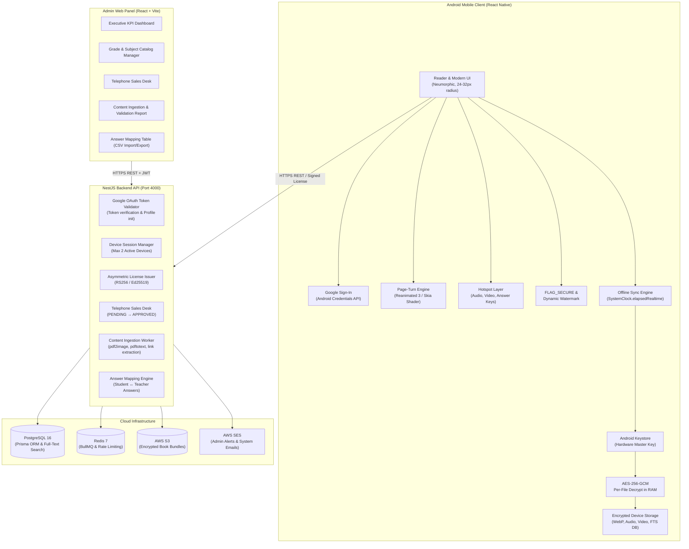

# SmartTeacherBook — Master System Architecture & Technical Specification
**Version:** 2.0.0 (Master Prompt Aligned) | **Phase:** Phase 0 (Architecture & Proof-of-Concept) | **Date:** 2026-11-08

---

## 1. Executive Summary & Core Platform Vision

SmartTeacherBook is an Android-first educational application and cloud platform built specifically for school teachers in Uzbekistan covering Grades 1–11 across all subjects.

The platform unites:
- **Student's Book** (Darslik)
- **Teacher's Book** (O‘qituvchi kitobi with exercise answers)
- **Workbook** (Ish daftari)
- **Listening Audio** attached to page hotspots and indexed in an audio library
- **Educational Videos** attached to page hotspots and indexed in a video library
- **Exercise Answers Linking** (Direct jump from Student's Book exercise to Teacher's Book answer key)
- **Searchable Textbook Content** (Full-text offline search)
- **Teacher Notes & Vector Annotations** (Pen, highlighter, sticky notes, local encrypted + cloud synced)
- **Offline Access & Licensing** (100% offline usage with asymmetric cryptographic token verification)

---

## 2. Educational Content Hierarchy (§4)

```text
Grade (1–11)
 └── Subject (e.g., Ingliz tili, Matematika, Fizika, Kimyo, Biologiya)
      ├── Student's Book
      │    ├── Pages (WebP 1x phone & 2x tablet/zoom)
      │    ├── Audio Hotspots (Listening tracks)
      │    ├── Video Hotspots (Grammar & lesson videos)
      │    └── Searchable Text Index
      │
      ├── Teacher's Book
      │    ├── Pages
      │    └── Exercise Answers (Mapped to Student's Book exercises)
      │
      └── Workbook
           ├── Pages
           └── Related Materials & Homework Tests
```

---

## 3. Technology Stack & Monorepo Structure

```text
smartteacherbook/
│
├── apps/
│   ├── mobile/         # React Native (Android SDK 35, Min SDK 24, Expo Prebuild / Dev Client)
│   ├── admin/          # React + Vite + TypeScript (Neumorphic Glass Admin & Reader PoC)
│   └── api/            # NestJS Backend API + PostgreSQL Prisma ORM + Ingestion Pipeline
│
├── packages/
│   └── shared/         # Shared TypeScript DTOs, Enums, Types, i18n (UZ, EN), Constants
│
├── docs/
│   └── architecture/   # Architecture blueprints and UI reference images
│
├── docker-compose.yml  # Multi-container orchestration (PostgreSQL, Redis, API, Admin)
├── pnpm-workspace.yaml # Monorepo configuration
└── README.md
```

---

## 4. Full-Stack Architecture Diagram



---

## 5. Authentication & User Accounts (§7)

1. **Google Sign-In Primary**:
   - No email OTP or passwords required for mobile teachers.
   - Flow: Language Selection (`uz` / `en`) → Tap "Continue with Google" → Native Google Account sheet → ID Token sent to NestJS → Backend validates with Google OAuth API → Issues session tokens.
2. **Device Limit (Max 2 Active Devices)**:
   - Backend tracks device hardware IDs.
   - If a 3rd device attempts login, the app displays the **Device Limit Screen** listing registered models and last active times, allowing the teacher to disconnect one device.

---

## 6. Subscription Model & Manual Telephone Sales (§8)

### Available Subscription Plans:
- **1 Month (Monthly)**: 30 days full offline access.
- **3 Months (Quarterly)**: 90 days term access.
- **1 Year (Yearly)**: 365 days full academic year.

### Sales State Machine:
`PENDING` → `AWAITING_PAYMENT` → `PAID_APPROVED` | `REJECTED` | `EXPIRED`
- Teacher submits phone number in format: `+998 XX XXX XX XX`.
- Confirmation message: *"Your request was received. We will contact you within 12 hours."* (English and Uzbek).
- Admin calls customer outside the app, verifies payment, and taps "Grant Access".
- Pluggable payment interface ensures future Google Play Billing, Click, or Payme integration without refactoring business logic.

---

## 7. Content Security & Anti Clock-Tampering (§10, §11)

1. **Hardware-Backed AES-256-GCM Envelope Encryption**:
   - Master key generated in Android Keystore (`KeyGenParameterSpec` with StrongBox / TEE).
   - Per-bundle AES-256-GCM keys wrapped by device master key.
   - Content copied to another phone cannot be decrypted.
2. **RAM Decryption Only**:
   - Page images are decrypted strictly into RAM bitmaps.
   - Audio and video stream-decrypt via memory buffers directly into ExoPlayer.
3. **Anti Clock-Tampering Engine**:
   - Syncs `serverTime` and hardware monotonic timer (`SystemClock.elapsedRealtime()`).
   - If the device wall clock is rolled backwards, content is locked immediately until an online sync occurs.
4. **FLAG_SECURE**:
   - Enforced on all Reader and Media screens to block screenshots, video capture, and recent task snapshots.
5. **Dynamic Watermark**:
   - Teacher's authenticated email and device ID overlay pages at low opacity (12%).

---

## 8. Digital Book Reader & Page-Curl Proof-of-Concept (§12)

- **Rendering Approach**: Pre-rendered WebP images (1x normal, 2x high-res zoom) + transparent hotspot layer (NEVER raw PDF).
- **Page-Curl Engine**: Reanimated 3 + Gesture Handler 2.5D page peeling with dynamic lighting and curl shadows (with smooth slide fallback for lower-end 2GB RAM devices).
- **Pinch-to-Zoom Coordination**: Page-curl gestures are automatically disabled while zoomed in (`scale > 1.0`) to allow smooth panning without accidental page turns.
- **Teacher's Book Answer Key**: Tapping "Answers" on Student's Book page 2 immediately opens Teacher's Book page 4 answer notes in a bottom sheet / side-by-side mode.

---

## 9. Database Schema (Prisma ORM)

Located in [`apps/api/prisma/schema.prisma`](file:///Users/a/Desktop/smarteacher%20book/apps/api/prisma/schema.prisma):
- `User` (Google ID, email, fullName, avatarUrl, isActive, isBlocked)
- `Device` (userId, deviceId, deviceModel, osVersion, lastActiveAt, isActive - Max 2 limit)
- `Admin` (email, passwordHash, role, totpSecret, totpEnabled)
- `AuditLog` (adminId, action, entityType, entityId, payload, ipAddress)
- `Grade` (id 1-11, gradeNumber, title, priceMonthlyUzs, priceQuarterlyUzs, priceYearlyUzs)
- `Subject` (id, gradeId, name, code, icon, color, description, isActive)
- `Book` (id, gradeId, subjectId, type, title, version, status, totalPages, manifestS3Key)
- `Page` (id, bookId, pageNumber, imageNormalS3Key, imageHighS3Key, textContent)
- `Hotspot` (id, pageId, type, rectX, rectY, rectW, rectH, targetMediaId, targetPageNumber)
- `Media` (id, bookId, type, filename, title, unitLabel, sizeBytes, checksumSha256, s3Key)
- `TocItem` (id, bookId, title, pageNumber, parentId, sortOrder)
- `AnswerMapping` (id, gradeId, subjectId, studentExerciseLabel, studentPageNumber, teacherPageNumber, notes)
- `AccessRequest` (id, userId, gradeId, subjectId, plan, phoneNumber, status, priceUzs, adminId)
- `Subscription` (id, userId, gradeId, subjectId, plan, startsAt, expiresAt, grantedById)
- `LicenseToken` (id, userId, deviceId, gradeId, subjectId, tokenString, signature, expiresAt)
- `UserBookmark`, `UserNote`, `UserDrawing`, `UserReadingProgress`, `AppSetting`.

---

## 10. Technical Risk Analysis & Mitigations (§21)

| Risk Identified | Severity | Mitigation Strategy |
| :--- | :--- | :--- |
| **Clock rollback to bypass 30/90/365-day expiry** | HIGH | Monotonic clock anchor (`SystemClock.elapsedRealtime`) recorded alongside server time; rollback locks content immediately. |
| **Encrypted files copied via USB to another device** | HIGH | Per-file keys wrapped by Android Keystore hardware-backed master key; cannot leave hardware. |
| **Pinch zoom conflicts with page curl** | MEDIUM | Curl gesture handlers explicitly disabled when zoom scale > 1.05. |
| **Performance hitching on 2GB RAM devices** | MEDIUM | Graceful fallback to zero-overhead Slide animation switchable in Settings. |
| **Google Play Billing policy for manual telephone payments** | HIGH | Payment layer abstracted behind interface; manual telephone flow for initial deployment, ready for Google Play Billing. |

---

## 11. Runnable Demonstration

- **Admin Web Panel & Live Mobile Simulator**: Running on **`http://localhost:5173`**
- **Mobile React Native Application**: Running on **`http://localhost:8081`**
