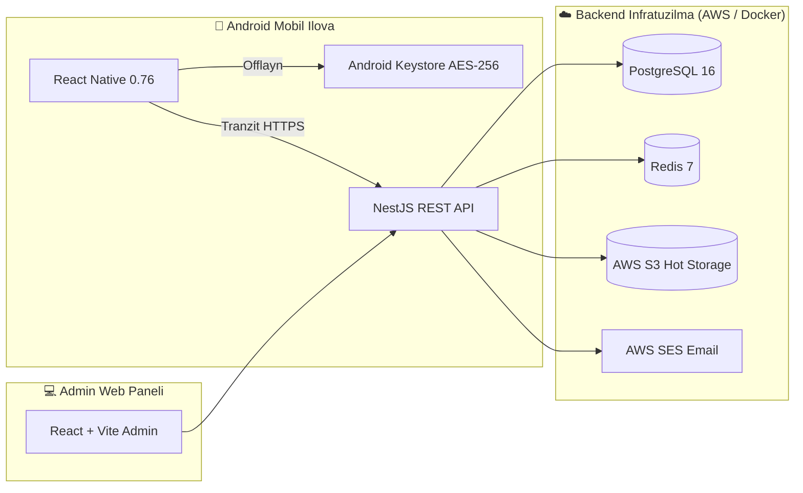

# SmartTeacherBook — Ishlab Chiqarish va Ekspluatatsiya Qo‘llanmasi (Operations Manual)

Ushbu hujjat **SmartTeacherBook** raqamli platformasining administratorlari, texnik qo‘llab-quvvatlash muhandislari va tizim arxitektorlari uchun rasmiy ekspluatatsiya va xizmat ko‘rsatish qo‘llanmasi hisoblanadi.

---

## 1. Tizim Arxitekturasi Xulosasi



- **Mobil Ilova**: Android (Min SDK 24, Target SDK 35, Build 6, v1.0.0). `com.smartteacherbook.app`.
- **Backend**: NestJS (TypeScript) + Prisma ORM + PostgreSQL 16 + Redis 7.
- **Admin Panel**: React + Vite + Tailwind CSS + Lucide Icons.
- **Xavfsizlik**: Monotonic Clock Anchor, Android Keystore Hardware AES-256-GCM, RSA-2048 litsenziyalar, 2 ta qurilma limiti, FLAG_SECURE.

---

## 2. Kundalik Ish Jarayonlari (Daily Operations)

### 2.1. Savdo Stoli (Sales Desk) va Buyurtmalarni Tasdiqlash
1. O‘qituvchi mobil ilovada kerakli sinfni tanlaydi va o‘z telefon raqamini kiritib, "So‘rov qoldirish" tugmasini bosadi.
2. NestJS API orqali Admin panelning **"Savdo Stoli"** (`/requests`) bo‘limiga yangi so‘rov tushadi va bir vaqtning o‘zida ma'murlar pochtasiga AWS SES orqali xabar boradi.
3. Operator o‘qituvchi bilan telefon orqali bog‘lanadi (yoki to‘lov chekini tekshiradi).
4. Operator so‘rov holatini `PENDING` dan `APPROVED` ga o‘tkazadi:
   - Obuna davri tanlanadi (1 oylik, 3 oylik yoki 1 yillik).
   - Tizim avtomatik ravishda **RSA-2048** raqamli kalit bilan imzolangan litsenziya yaratadi.
   - O‘qituvchining mobil ilovasida o‘sha sinf darhol faollashadi va kitoblar to‘plamini offlayn yuklab olish tugmasi ochiladi.

### 2.2. O‘qituvchilar Qurilmalarini Boshqarish (2-Device Limit)
- Har bir o‘qituvchi ko‘pi bilan 2 ta qurilmadan foydalana oladi.
- Agar o‘qituvchi telefonini yo‘qotsa yoki yangi planshet sotib olsa, Admin panelning **"O‘qituvchilar"** (`/users`) bo‘limiga kiring:
  - O‘qituvchi profilini oching.
  - Faol qurilmalar ro‘yxatidan eskisini topib, **"Qurilmani uzish (Revoke)"** tugmasini bosing.
  - Shundan so‘ng o‘qituvchi yangi qurilmasidan bemalol kirishi mumkin bo‘ladi.

---

## 3. Kontent Yuklash va Yangilash (Ingestion Studio)

Yangi sinf yoki yangi darsliklarni qo‘shish jarayoni:

### 1-qadam: Materiallarni Tayyorlash
- Darslikning original PDF fayli.
- Sahifalarda ko‘rsatilgan barcha tinglash audio fayllari (`.mp3` formatda, 128 kbps tavsiya etiladi).
- Darslik videolari (`.mp4` formatda, H.264/AAC, 720p/1080p).

### 2-qadam: Ingestion Studioda Yuklash
1. Admin panelda **"Ingestion Studio"** bo‘limiga o‘ting.
2. Kerakli sinf (1-11) va kitob turini tanlang (`Student's Book`, `Teacher's Book`, yoki `Workbook`).
3. PDF faylni va audio/video papkalarini yuklang.
4. Tizim avtomatik ravishda:
   - Har bir sahifani yuqori sifatli WebP formatiga o‘tkazadi;
   - Matnlarni to‘liq qidiruv indeksiga kiritadi;
   - PDF dagi barcha havola va audio/video koordinatalarini avtomatik ajratib oladi (`HotspotLayer`);
   - SHA-256 nazorat yig‘indilarini (checksums) hisoblab, xavfsiz `bundle manifest` shakllantiradi.

### 3-qadam: Mashq Javoblarini Bog‘lash (Answer Mapping)
1. **"Javoblar (Keys)"** bo‘limiga o‘ting.
2. Student's Book dagi mashq raqami va sahifasini Teacher's Book dagi mos sahifa bilan bog‘lang.
3. Ko‘p sonli javoblar uchun tayyor `.csv` shablonini yuklab olib, ommaviy import qilishingiz mumkin.

---

## 4. Zaxiralash va Falokatdan Qutqarish (Backups & Disaster Recovery)

### 4.1. Avtomatik Zaxiralash (Cron Job)
Serverda har kuni tungi soat 03:00 da avtomatik zaxira nusxasi yaratilishi lozim:
```bash
# Crontab ga qo'shing:
0 3 * * * /opt/smartteacherbook/infrastructure/scripts/backup-database.sh >> /var/log/stb_backup.log 2>&1
```
- Zaxira fayllari: `/var/backups/smartteacherbook/stb_backup_YYYYMMDD_HHMMSS.sql.gz`
- 30 kundan oshgan eski nusxalar avtomatik tozalanadi.
- Agar `AWS_S3_BACKUP_BUCKET` ko‘rsatilgan bo‘lsa, nusxalar bir zumda S3 bulutli xotirasiga sinxronlanadi.

### 4.2. Zaxiradan Qayta Tiklash (Restore)
Agar ma'lumotlar bazasida nosozlik yuz bersa:
```bash
./infrastructure/scripts/restore-database.sh /var/backups/smartteacherbook/stb_backup_20260101_030000.sql.gz
```

---

## 5. Yangilanishlarni Ishga Tushirish (Deployment)

### 5.1. Backend va Admin Panelni Yangilash (Nol Uzilish)
```bash
cd /opt/smartteacherbook
git pull origin main
docker-compose -f infrastructure/docker/docker-compose.prod.yml build
docker-compose -f infrastructure/docker/docker-compose.prod.yml up -d --remove-orphans
```

### 5.2. Yangi Mobil Versiyani Chiqarish (Release Build)
Yangi versiyani (masalan v1.0.1, build 7) chiqarish uchun:
1. `apps/mobile/app.json` da `version: "1.0.1"` va `versionCode: 7` qilib yangilang.
2. Build skriptini ishga tushiring:
   ```bash
   # Docker orqali (hech qanday Java yoki SDK o'rnatmasdan):
   ./infrastructure/scripts/build-android-docker.sh
   
   # Yoki Expo EAS buluti orqali:
   cd apps/mobile && pnpm run build:cloud:aab
   ```
3. Yaratilgan `smartteacherbook-v1.0.1.aab` faylini Google Play Console ga yuklang.

---

## 6. Muammolarni Hal Qilish (Troubleshooting Playbook)

| Alomat / Xatolik | Mumkin Bo‘lgan Sabab | Yechim |
| :--- | :--- | :--- |
| O‘qituvchida "Qurilma chegarasi oshdi" xatosi chiqmoqda | Foydalanuvchi hisobiga 2 ta qurilma ulangan | Admin paneldan eski qurilmani "Revoke" qiling. |
| O‘qituvchida "Vaqt nomutanosibligi aniqlandi" qulfi chiqmoqda | Foydalanuvchi telefon soatini orqaga surgan | Telefon sozlamalarida "Tarmoq vaqtidan foydalanish (Automatic time)" ni yoqishni so‘rang. |
| Darslik rasmlari yoki audio yuklanmayapti | S3 saqlash xizmati kalitlari yoki tarmoq uzilgan | `.env` dagi `AWS_S3_BUCKET_NAME` va ruxsatlarni tekshiring. |
| API 500 xatosi qaytarmoqda | PostgreSQL ulanishlar chegarasi to‘lgan yoki disk to‘lgan | `docker logs stb_prod_api` va `docker stats` orqali xotirani tekshiring. |
